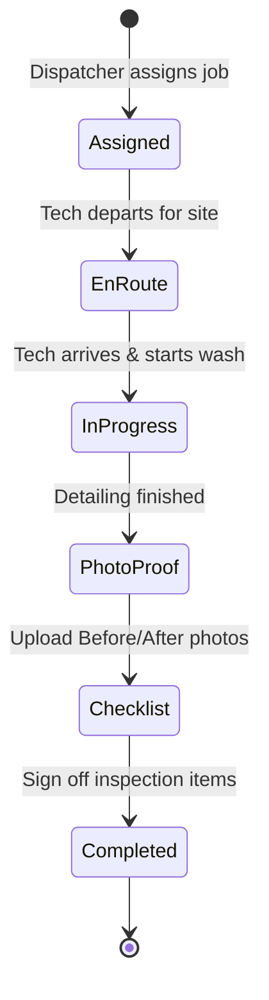
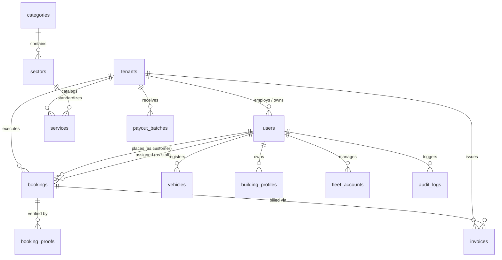

# Clean.et — Master Exhaustive Feature Specification, Operational Architecture & Administration Manual

> **Document Version**: 4.0.0 (Comprehensive Master Edition)  
> **Release Date**: September 2026  
> **Platform Classification**: Multi-Tenant Facility, Auto Detailing & On-Demand Service Management Ecosystem  
> **Headquarters**: Addis Ababa, Ethiopia (Regional East Africa Platform)  
> **Target Audience**: Technical Architects, Product Executives, Franchise Partners, Operations Leads, Field Managers, and Compliance Auditors  

---

## Table of Contents

1. [Executive Overview & Platform Philosophy](#1-executive-overview--platform-philosophy)
2. [Universal Frontend Architecture & Foundation](#2-universal-frontend-architecture--foundation)
3. [Exhaustive Client-Facing Feature Specification (Screen-by-Screen)](#3-exhaustive-client-facing-feature-specification-screen-by-screen)
   * 3.1 Authentication & Registration (`/(auth)/login`, `/(auth)/register`)
   * 3.2 Home Screen & Discovery Cockpit (`/(tabs)/home`)
   * 3.3 Explore & Real-Time Filtering Directory (`/(tabs)/explore`)
   * 3.4 Dynamic Sector Booking Engine (`/booking/[sectorId]`)
   * 3.5 Live Booking Tracker & Proof Verification (`/booking/status/[bookingId]`)
   * 3.6 Bookings History & Management (`/(tabs)/bookings`)
   * 3.7 Customer Asset Hub: Vehicle Garage (`/vehicles`)
   * 3.8 Customer Asset Hub: Building Profiles (`/building-profiles`)
   * 3.9 Customer Asset Hub: Corporate Fleet Accounts (`/profile/fleet`)
   * 3.10 Invoicing & Tax Receipts (`/invoices`, `/invoices/[id]`)
   * 3.11 Payment Methods Hub (`/profile/payments`)
   * 3.12 Profile & User Dossier (`/(tabs)/profile`)
   * 3.13 Personal Information Editor (`/profile/personal-info`)
   * 3.14 Security & Notification Settings (`/profile/settings`)
   * 3.15 Help, Support Channels & FAQ (`/profile/help`)
   * 3.16 Privacy Policy & Data Protocols (`/profile/privacy`)
4. [Field Crew & Technician Mobile Workflow](#4-field-crew--technician-mobile-workflow)
   * 4.1 Dispatch Notification & Job Acceptance
   * 4.2 Turn-by-Turn GPS Navigation
   * 4.3 Operational State Machine (En Route $\rightarrow$ In Progress $\rightarrow$ Completed)
   * 4.4 High-Resolution Photographic Proof-of-Work Upload
   * 4.5 Digital Inspection Checklist Sign-Off
   * 4.6 Duty Status Toggles
5. [Tenant Admin Operations Command Center (Dashboard-by-Dashboard)](#5-tenant-admin-operations-command-center-dashboard-by-dashboard)
   * 5.1 Real-Time Operations Hub (`/(admin)/(tabs)/dashboard`)
   * 5.2 Kanban Booking Dispatch Pipeline (`/(admin)/(tabs)/bookings`)
   * 5.3 Booking Inspector & Technician Assignment Modal (`/(admin)/booking-details`)
   * 5.4 Branch Service Catalog CRUD (`/(admin)/services`)
   * 5.5 Crew Roster & Skill Certification Management (`/(admin)/staff`)
   * 5.6 Customer Relationship Management (CRM) (`/(admin)/customers`)
   * 5.7 VAT Invoicing & Billing Lifecycle (`/(admin)/invoices`, `/(admin)/invoice-details`)
   * 5.8 Branch Financial & Volume Analytics (`/(admin)/reports`)
6. [Super Admin Platform Governance Cockpit (Module-by-Module)](#6-super-admin-platform-governance-cockpit-module-by-module)
   * 6.1 Global GMV & Analytics Oversight (`/super-admin/analytics`)
   * 6.2 Franchise Partner Onboarding & Governance (`/(admin)/tenants`)
   * 6.3 Commission Settlement & Automated Net Payout Engine (`/super-admin/payouts`)
   * 6.4 Platform-Wide Financial Ledger & Tax Reports (`/super-admin/reports`)
   * 6.5 Infrastructure Telemetry & Health Diagnostics (`/super-admin/health`)
   * 6.6 Immutable Platform Security Audit Trail (`/super-admin/audit-logs`)
   * 6.7 Omnichannel Push & SMS Broadcast Engine (`/(admin)/broadcast`)
   * 6.8 System Parameters & Fee Configuration (`/super-admin/settings`)
7. [Dynamic Requirement Schema & Pricing Engine](#7-dynamic-requirement-schema--pricing-engine)
8. [Database Architecture & Complete Data Dictionary](#8-database-architecture--complete-data-dictionary)
9. [Complete REST API Catalog (40+ Endpoints)](#9-complete-rest-api-catalog-40-endpoints)
10. [Security, Multi-Tenancy Boundaries & Compliance](#10-security-multi-tenancy-boundaries--compliance)
11. [Granular Role Permissions Matrix (Can Do vs Cannot Do)](#11-granular-role-permissions-matrix-can-do-vs-cannot-do)

---

## 1. Executive Overview & Platform Philosophy

**Clean.et** is an enterprise-grade, cloud-native facility maintenance, commercial sanitation, and automotive detailing ecosystem designed to digitize and scale service operations across East Africa. Tailored specifically for the operational and payment realities of the Ethiopian market (telebirr, CBE, cash-on-delivery, and credit/debit cards), Clean.et unifies individual consumers, corporate property managers, vehicle fleet operators, and certified cleaning franchises into a single real-time ecosystem.

### Core Strategic Objectives
1. **Eliminate Arbitrary Pricing**: Replace manual haggling with dynamic, schema-driven pricing algorithms that compute quotes transparently based on vehicle dimensions, building square meters, and frequency rules.
2. **Guarantee Operational Accountability**: Every job lifecycle includes mandatory before-and-after photographic evidence, digital inspection checklist sign-offs, and GPS tracking.
3. **Isolate Multi-Tenant Operations**: Independent cleaning companies and franchise operators run their business on Clean.et with strict data isolation, custom service catalogs, local pricing, certified staff rosters, and branch billing.
4. **Automate Corporate Governance**: Platform owners maintain global visibility over Gross Merchandise Value (GMV), enforce contract commission rates (10%–15%), automate net payout batches, and inspect immutable audit logs.

---

## 2. Universal Frontend Architecture & Foundation

The Clean.et frontend is engineered with **Expo SDK 52+ / React Native 0.76+**, delivering a universal, single-codebase experience across iOS, Android, and Web (`react-native-web`).

* **File-System Routing (`Expo Router`)**: Type-safe dynamic routes (`/booking/[sectorId]`, `/booking/status/[bookingId]`, `/(admin)/*`, `/(tabs)/*`).
* **Semantic Token Design System (`useColors`)**: Unified color palette automatically adapting between light and dark themes with high-contrast text ratios.
* **Theme Switching (`ThemeContext`)**: Real-time theme switching persisted to `AsyncStorage` without requiring app reload.
* **Four-Language Localization (`LanguageContext`)**: Instant translation across **English**, **Amharic (አማርኛ)**, **Afaan Oromoo**, and **Tigrinya (ትግርኛ)**.
* **Global Web Input Reset**: Injected global stylesheet stripping native browser focus outlines (`outline: none !important`) and default input borders for an ultra-clean, native mobile aesthetic on desktop and mobile web.
* **Haptics & Hardware Blurs**: Hardware-accelerated blurs (`expo-blur`), spring micro-animations (`react-native-reanimated`), and tactile feedback (`expo-haptics`).

---

## 3. Exhaustive Client-Facing Feature Specification (Screen-by-Screen)

### 3.1 Authentication & Registration (`/(auth)/login`, `/(auth)/register`)
* **Dual Login Toggle**:
  * **Phone Number Mode**: Default Ethiopian national format (`🇪🇹 +251 9XX XXX XXXX`) with automatic input formatting and sanitization.
  * **Email Address Mode**: RFC-compliant email address input.
* **Authentication Options**:
  * **OTP Login**: One-time SMS/Email pin verification for passwordless sign-in.
  * **Password Login**: Secure password authentication with visibility toggle eye icon.
* **Input Sanitization & Error Handling**: Inline red validation indicators highlighting format errors, rate limits, or invalid credentials.
* **Session Persistence**: Secure storage of Sanctum Personal Access Token (`AsyncStorage.setItem('@token', ...)`) with automatic session restoration on app launch.
* **Registration Dossier**: Collects full name, phone number, email address, password, password confirmation, and terms of service agreement checkbox. Auto-provisions the user with the `customer` role.

### 3.2 Home Screen & Discovery Cockpit (`/(tabs)/home`)
* **Header & Identity**:
  * Personalized greeting based on current local time (*"Good morning"*, *"Good afternoon"*, *"Good evening"*).
  * User avatar badge showing name initials with one-tap deep link to the Profile tab.
  * Operating city indicator badge (*"Addis Ababa"*).
  * Real-time unread notification bell with badge counter polling `/api/notifications/unread-count`.
* **Auto-Sliding Promotional Hero Carousel**:
  * Rotating banners (4.5-second interval) highlighting core offerings:
    1. *On-Demand Car Washing 24/7* (Special 20% off).
    2. *Enterprise Building Cleaning* (Verified crew for facade glass & interiors).
    3. *Valet Pickup & Drop-Off* (Insured valet dispatch).
  * Deep links directly to corresponding sector booking forms.
* **Active Booking Alert Card**:
  * Automatically detects any active booking in `pending`, `confirmed`, `driver_assigned`, or `in_progress` state.
  * Displays service name, scheduled date/time, assigned technician name, and a prominent button to open the live tracking pipeline.
* **Category Selector Pills**:
  * Filter pills for **All Services**, **Car Wash**, and **Building Cleaning** with active color highlights and tactile haptic feedback.
* **Quick Search Bar**:
  * Real-time text search filtering the sector cards dynamically.
* **Sector Services Grid**:
  * Displays all available sectors: Standard Bay Wash, Mobile Home-to-Home Wash, Valet Pickup & Drop-Off, Corporate Fleet, Interior Building Cleaning, Exterior Facade Cleaning.
  * Each card displays: Starting price in ETB, estimated duration, sector description, verified badge, and instant "Book Now" button.
* **Professional Cleaning Tips Carousel**:
  * 5 rotating advice cards: *Rinse Before Washing*, *Two-Bucket Method*, *Top-Down Building Wash*, *Eco-Friendly Agents*, and *Book in Advance*.
* **Enterprise Guarantee Banner**:
  * 100% satisfaction guarantee badge featuring verified crew badges and eco-friendly wash certifications.

### 3.3 Explore & Real-Time Filtering Directory (`/(tabs)/explore`)
* **Live Keyword Search**: Instant searching across service titles, subtitles, category names, and feature tags.
* **Multi-Category Pills**: Filter across All Services, Car Wash, and Building Cleaning.
* **Sorting Mechanism**:
  * **Most Popular**: Prioritizes verified popular packages.
  * **Price (Low to High)**: Sorts by numerical base price in ETB.
  * **Top Rated**: Sorts descending by customer review stars (e.g., 4.95 $\rightarrow$ 4.85).
* **Special Promo Banner**: Deep link to Doorstep Steam Detailing Combo with 20% promotional discount.
* **Rich Service Cards**:
  * Card top row: Category icon, division badge (*Car Wash*, *Building*), and highlight tags (*Most Popular*, *Health & Hygiene*, *Best Value*).
  * Title & subtitle.
  * Detailed feature checklist with checkmark icons (e.g., *Pre-rinse & Snow Foam*, *Hand-dry with Plush Microfiber*, *Tire Dress & Rim Polish*).
  * Review ratings count and duration badge.
  * Starting price in ETB and "Book Now" CTA.
* **Empty State**: Custom vector graphic and "Reset All Filters" button when no results match search criteria.

### 3.4 Dynamic Sector Booking Engine (`/booking/[sectorId]`)
* **Dynamic Header**: Sector title, back navigation arrow, and live estimated price display.
* **Dynamic Requirement Schema Fields**: Dynamically generated input fields based on `/api/sectors/{id}/schema`:
  * *Select fields*: Bottom sheet pickers for vehicle class (Sedan, Compact SUV, Large SUV, Van/Truck).
  * *Text fields*: License plate number, specific location instructions, parking bay codes.
  * *Number fields*: Floor count, square meters of facility.
  * *Boolean toggles*: Add-on options (e.g., Engine bay steam cleaning, leather conditioning).
  * *Address field*: Service location with GPS coordinates.
* **Customer Asset Selection Chips**:
  * When booking automotive detailing: Horizontally scrollable chips displaying customer's saved vehicles (`🚗 Toyota Land Cruiser (AA 45210)`). Tapping auto-populates vehicle class and plate number.
  * When booking building cleaning: Horizontally scrollable chips displaying customer's saved building profiles (`🏢 HQ Office (4F, 850 sqm)`). Tapping auto-populates floor count and area.
* **Recurring Frequency Engine**:
  * **One-Time Cleaning**: Full standard rate.
  * **Weekly Maintenance**: 15% discount automatically applied to live quote.
  * **Bi-Weekly Maintenance**: 10% discount automatically applied to live quote.
  * **Monthly Deep Clean**: 5% discount automatically applied to live quote.
* **Interactive Calendar & Date Picker**:
  * Horizontal date ribbon displaying day of the week, day number, and month for the next 14 rolling days.
  * Active date indicator with contrast pill highlight.
* **Time Slot Allocation**:
  * 11 daily slots from 08:00 AM to 06:00 PM.
  * Prevents booking past time slots for current-day bookings.
* **Payment Method Selector**:
  * Telebirr (instant mobile wallet transfer).
  * Commercial Bank of Ethiopia (CBE / CBE Birr).
  * Debit / Credit Card.
  * Cash on Delivery (paid to crew upon completion).
* **Cost Summary**:
  * Base service price, frequency discount deduction, dynamic add-ons, and net total in ETB.
* **Submission Engine**:
  * Validates all mandatory fields, displays a loading spinner, sends `POST /api/bookings`, triggers a success animation modal, and routes directly to the live tracking screen.

### 3.5 Live Booking Tracker & Proof Verification (`/booking/status/[bookingId]`)
* **6-Stage Visual Pipeline Tracker**:
  $$\text{Pending} \longrightarrow \text{Confirmed} \longrightarrow \text{Assigned} \longrightarrow \text{En Route} \longrightarrow \text{In Progress} \longrightarrow \text{Completed}$$
* **Assigned Crew Dossier**:
  * Technician profile picture, full name, phone number, and direct "Call Technician" button.
* **Photographic Proof-of-Work Gallery**:
  * Once the job is completed, displays high-definition **Before Photos** and **After Photos** side by side.
  * Full-screen image zoom modal for inspecting detailing quality.
* **Completed Quality Checklist**:
  * Displays verified checklist points checked off on-site by the technician (e.g., *Rims cleaned*, *Glass dried*, *Mats vacuumed*).
* **Self-Service Cancellation Workflow**:
  * Active when the booking is in `pending` or `confirmed` status.
  * Prompts for cancellation confirmation with refund policy reminder.
* **Invoice Download**:
  * One-tap button navigating directly to the official tax invoice upon job completion.

### 3.6 Bookings History & Management (`/(tabs)/bookings`)
* **Status Tab Filters**: Filter bookings by `All`, `Active`, `Upcoming`, `Completed`, and `Cancelled`.
* **Booking Cards**:
  * Service title, Booking ID (`#BK-8492`), scheduled date, time slot, and total price in ETB.
  * Status badge with color-coded theme (Pending: yellow, Confirmed: blue, In Progress: purple, Completed: green, Cancelled: red).
* **Pull-to-Refresh**: Synchronizes booking states with backend API.

### 3.7 Customer Asset Hub: Vehicle Garage (`/vehicles`)
* **Garage Listing**: Displays all customer vehicles with Make, Model, Year, Color, License Plate, and Vehicle Class (Sedan, Compact SUV, Large SUV, Van/Truck).
* **Add Vehicle Modal**: Form capturing vehicle specifications with real-time validation.
* **Edit Vehicle Modal**: Update license plate, color, or class.
* **Delete Vehicle Confirmation**: Removes vehicle from garage without affecting past booking histories.

### 3.8 Customer Asset Hub: Building Profiles (`/building-profiles`)
* **Property Dossier**: Displays facility specifications: Building name, street address, floor count, total area in square meters (sqm), access instructions, and gate entry codes.
* **Add / Edit Profile Form**: Saves facility parameters for 1-tap auto-fill during booking.
* **Delete Profile**: Safely removes property record.

### 3.9 Customer Asset Hub: Corporate Fleet Accounts (`/profile/fleet`)
* **Corporate Account Details**: Company name, Taxpayer Identification Number (TIN), corporate billing contact person, official email, and phone.
* **Pooled Vehicles Manager**: Link dozens of corporate vehicles, delivery vans, and trucks under one centralized billing profile.

### 3.10 Invoicing & Tax Receipts (`/invoices`, `/invoices/[id]`)
* **Invoice Listing**: Displays invoice number, booking reference, date of issuance, total amount in ETB, and payment status (`paid`, `unpaid`, `overdue`).
* **Detailed VAT Invoice View**:
  * Official Clean.et / franchise header with registered tax numbers.
  * Customer name, phone, service date, and address.
  * Itemized cost table: Base package, equipment charges, frequency discount deduction, VAT (15%), and net payable in ETB.
  * Print and PDF download triggers for corporate expense filing.

### 3.11 Payment Methods Hub (`/profile/payments`)
* **Linked Wallets & Cards**:
  * Telebirr wallet phone number link.
  * Commercial Bank of Ethiopia (CBE) account number link.
  * Credit / Debit card details.
* **Default Payment Method**: Set primary payment source for express checkout.

### 3.12 Profile & User Dossier (`/(tabs)/profile`)
* **User Identity Card**: Name initials avatar, full name, phone number, email address, and role badge (`Customer`, `Staff`, `Admin`, `Super Admin`).
* **Preferences Toggles**:
  * Dark / Light mode toggle switch.
  * Language selector dropdown (English, Amharic, Afaan Oromoo, Tigrinya).
* **Navigation Tray**: Links to Personal Info, Vehicles, Building Profiles, Fleet, Payments, Invoices, Settings, Privacy, and Help.
* **Role Switcher**: Visible only to users with `admin` or `super_admin` roles to jump directly to the administrative dashboard.
* **Logout Dialog**: Clears authentication tokens and resets app state.

### 3.13 Personal Information Editor (`/profile/personal-info`)
* Update full name, contact phone number, email address, and profile photo.

### 3.14 Security & Notification Settings (`/profile/settings`)
* Notification toggles: Push notifications, SMS alerts, Email invoice receipts.
* Password Management: Change password modal requiring current password verification.
* Biometric Authentication: Toggle Face ID / Fingerprint unlock for mobile devices.

### 3.15 Help, Support Channels & FAQ (`/profile/help`)
* Interactive accordion FAQ: Cancellation policies, inclement weather rain-checks, damage guarantees, valet driver insurance.
* Live Customer Support Channels: Direct phone hotline, Email, WhatsApp, and Telegram integration.

### 3.16 Privacy Policy & Data Protocols (`/profile/privacy`)
* Comprehensive privacy policy outlining location tracking policies, payment encryption, and multi-tenant data isolation.

---

## 4. Field Crew & Technician Mobile Workflow

Field crew members access a specialized, lightweight mobile interface optimized for on-site operations:



1. **Job Dispatch Alert**: Push notification received on mobile phone with service time, customer address, vehicle specs, and arrival deadline.
2. **Turn-by-Turn Navigation**: Deep link to GPS maps directly to the customer's vehicle parking location or building gate.
3. **Operational State Machine**:
   * **"En Route"**: Notifies the customer that the cleaning rig is on its way.
   * **"In Progress"**: Logged when technician arrives and begins cleaning.
   * **"Completed"**: Activates proof upload.
4. **Before & After Photographic Evidence**:
   * Technician captures high-resolution before photos (dirt on rims, stains on seats, unwashed facade) and after photos (sparkling finish, polished glass).
   * Images are compressed and stored with the booking record.
5. **Quality Inspection Checklist**:
   * Mandatory sign-off items (Rims cleaned, door jambs wiped, glass streak-free, equipment packed) before the job can be officially closed.
6. **Live Duty Status**:
   * Technicians can toggle between `Available` (ready for dispatches) and `Off-Duty` (shift ended).

---

## 5. Tenant Admin Operations Command Center (Dashboard-by-Dashboard)

The Tenant Admin portal is the command center for cleaning companies, detailers, and franchise operators.

```
Tenant Admin Navigation Hierarchy:
├── (admin)/(tabs)
│   ├── Dashboard (Real-time KPIs, Today's Revenue, Active Cleaners, Urgent Action Alerts)
│   ├── Bookings (Kanban Pipeline: Pending, Confirmed, In Progress, Completed, Cancelled)
│   └── Profile (Tenant company profile, contact details, branch settings, logout)
├── (admin)/booking-details (Customer requirement inspect, Technician assignment modal)
├── (admin)/services (Service catalog CRUD, Base pricing, Duration, Schema linkage)
├── (admin)/staff (Crew roster, Duty status toggles, Skill certifications)
├── (admin)/customers (CRM client directory, Lifetime booking history, Total spend)
├── (admin)/invoices (Booking-to-invoice conversion, Tax calculation, Status tracking)
├── (admin)/invoice-details (Itemized invoice view, Print & download receipt)
└── (admin)/reports (Branch revenue, Volume trends, Staff productivity metrics)
```

### 5.1 Real-Time Operations Hub (`/(admin)/(tabs)/dashboard`)
* **Today's Gross Billings**: Revenue generated by the branch during the active cycle in ETB.
* **Active Field Techs**: Number of cleaners currently on duty or en route.
* **Pending Orders Alert**: Prominent counter highlighting incoming orders requiring immediate review.
* **Completed Jobs Count**: Daily operational milestone counter.
* **Urgent Action Tray**: High-priority jobs scheduled for immediate time slots with 1-tap dispatch access.

### 5.2 Kanban Booking Dispatch Pipeline (`/(admin)/(tabs)/bookings`)
* **Status Segregation**: Filter jobs across `All`, `Pending`, `Confirmed`, `In Progress`, `Completed`, and `Cancelled`.
* **Rapid Search**: Search by customer name, booking ID, phone number, or scheduled date.
* **Technician Dispatch Modal**: Dropdown selector listing all currently `Available` technicians filtered by service certification.

### 5.3 Booking Inspector & Technician Assignment Modal (`/(admin)/booking-details`)
* **Customer Requirements Review**:
  * Full inspection of dynamic field submissions (e.g., Vehicle model: Toyota Land Cruiser, Plate: AA 45210; Building area: 850 sqm, 4 floors).
  * Inspection of customer notes, gate instructions, and special requests.
* **Technician Assignment Modal**:
  * Dropdown selector listing currently available certified technicians.
  * Instant status transition to `Confirmed` and automated dispatch notification sent to the technician's mobile device.

### 5.4 Branch Service Catalog CRUD (`/(admin)/services`)
* **Branch Service Catalog**:
  * Add, edit, or disable specific cleaning offerings under the tenant's enabled categories.
  * Configure pricing models (fixed package price, variable per square meter, or hourly rate).
  * Set estimated duration in minutes for accurate scheduling.
* **Schema Linkage**: Connect services to the platform's dynamic requirement schemas to collect necessary job parameters at checkout.

### 5.5 Crew Roster & Skill Certification Management (`/(admin)/staff`)
* **Technician Dossier**: Full technician records including contact info, employment date, and operational history.
* **Live Duty Availability**: Toggle availability states (`Available` for dispatch, `Busy` on-site, `Off-Duty`).
* **Specialized Certifications**: Log qualifications (Industrial Steam Detailing, Facade Glass Scaffolding, Chemical Safety).

### 5.6 Customer Relationship Management (CRM) (`/(admin)/customers`)
* **Customer Directory**: Centralized list of all clients who have ordered from this franchise.
* **Lifetime Metrics**: Total orders completed, lifetime spend (LTV) in ETB, and direct contact options.

### 5.7 VAT Invoicing & Billing Lifecycle (`/(admin)/invoices`, `/(admin)/invoice-details`)
* **1-Tap Generation**: Generate formal tax invoices directly from completed bookings (`/admin/invoices/generate/{bookingId}`).
* **Payment Tracking**: Monitor and update invoice states (`unpaid`, `partially_paid`, `paid`, `overdue`).

### 5.8 Branch Financial & Volume Analytics (`/(admin)/reports`)
* Filter by date interval, service category, and payment channel.
* Real-time metrics on gross revenue, average booking value, completed volume, and cancellation rates.
* One-click CSV and Excel export engine for branch tax accountants.

---

## 6. Super Admin Platform Governance Cockpit (Module-by-Module)

The Super Admin portal is the master platform cockpit for Clean.et executive operators and platform owners.

```
Super Admin Governance Hierarchy:
├── (admin)/tenants (Franchise onboarding, Commission % rules, Activation/Suspension)
├── /super-admin/analytics (Global GMV, Category heatmaps, Platform commission pool)
├── /super-admin/payouts (Automated payout batch generation, Net settlement, Receipts)
├── /super-admin/reports (Multi-tenant filtered reporting, CSV/Excel export engine)
├── /super-admin/health (Infrastructure diagnostics, DB latency, Cache, Queue workers)
├── /super-admin/audit-logs (Immutable platform security audit trail)
├── /super-admin/broadcast (System-wide push notifications and SMS broadcasts)
└── /super-admin/settings (Global platform fee rates, Default currency, Operating parameters)
```

### 6.1 Global GMV & Analytics Oversight (`/super-admin/analytics`)
* **Gross Merchandise Value (GMV)**: Cumulative transaction value across all franchises in ETB.
* **Platform Commission Pool**: Real-time aggregation of platform earnings based on individual tenant commission contracts.
* **Volume Metrics**: Total active franchises, global customers, registered field staff, and global booking count.
* **Booking Funnel Breakdown**: Visual metrics detailing global bookings across:
  * `Pending` $\rightarrow$ `Confirmed` $\rightarrow$ `In Progress` $\rightarrow$ `Completed` $\rightarrow$ `Cancelled`.
* **Category Heatmap**: Real-time breakdown of service demand across Mobile Car Detailing vs. Building Cleaning.
* **Monthly Revenue Trends**: Trajectory charts comparing GMV against platform commissions over 12 rolling months.

### 6.2 Franchise Partner Onboarding & Governance (`/(admin)/tenants`)
* **Partner Onboarding**:
  * Register new cleaning company partners (`business_name`, `slug`, `contact_email`, `phone`, `city`, `address`).
  * Assign subscription tiers: **Starter**, **Growth**, or **Enterprise**.
  * Configure enabled categories (e.g., restrict a partner to only car detailing or grant full facility coverage).
  * Set partner commission rate (default 10%–15%).
* **Tenant Lifecycle Control**: One-click **Activate** or **Suspend** controls to temporarily freeze compromised or delinquent franchises.
* **Administrator Credential Provisioning**: Create primary and secondary Tenant Admin accounts directly linked to the specific `tenant_id`.

### 6.3 Commission Settlement & Automated Net Payout Engine (`/super-admin/payouts`)
* **Automated Payout Generation**: System calculates net earnings per tenant over selected billing cycles:
  $$\text{Net Payout} = \text{Gross Completed Bookings} - \text{Platform Commission} - \text{Processing Fees}$$
* **Payout Lifecycle State Machine**:
  * `Pending`: Automated computation awaiting financial approval.
  * `Processing`: Bank or Telebirr transfer initiated.
  * `Paid`: Settlement completed with bank transaction reference.
  * `Reconciled`: Verified by finance department.
* **Settlement Documentation**: Itemized digital payout receipts and comprehensive CSV ledger exports.

### 6.4 Platform-Wide Financial Ledger & Tax Reports (`/super-admin/reports`)
* Consolidated cross-franchise financial reporting.
* Filter by tenant, date interval, payment channel, and service sector.
* Direct CSV / Excel export for external platform tax audits.

### 6.5 Infrastructure Telemetry & Health Diagnostics (`/super-admin/health`)
* Real-time latency checks for MySQL/PostgreSQL database connections.
* Redis / Cache subsystem hit rates and memory usage.
* Background queue worker status and failed jobs monitor.
* Server environment metrics: PHP version, Laravel version, server uptime, and storage capacity.

### 6.6 Immutable Platform Security Audit Trail (`/super-admin/audit-logs`)
* Immutable security activity log recording:
  * Timestamp.
  * Actor User ID and Actor Name.
  * Action Verb (e.g., `tenant.suspended`, `payout.approved`, `booking.cancelled`).
  * Target Entity Type and Entity ID.
  * Client IP Address.
  * JSON Payload Diff (before and after values).

### 6.7 Omnichannel Push & SMS Broadcast Engine (`/(admin)/broadcast`)
* Broadcast system notifications or marketing campaigns across push notifications, in-app banners, and SMS.
* Audience segmentation: **All Users**, **Customers Only**, **Cleaning Staff Only**, or **Franchise Administrators Only**.

### 6.8 System Parameters & Fee Configuration (`/super-admin/settings`)
* Global platform service fee percentages.
* Default platform currency (`ETB`).
* Operating tax / VAT rates (15%).

---

## 7. Dynamic Requirement Schema & Pricing Engine

Rather than using rigid, hardcoded forms for every cleaning type, Clean.et utilizes a **Dynamic Requirement Schema Engine**:

```json
{
  "sector_id": 1,
  "slug": "mobile-car-wash",
  "name": "Mobile Car Wash & Detailing",
  "base_price": 450,
  "fields": [
    {
      "key": "vehicle_class",
      "type": "select",
      "label": "Vehicle Size Class",
      "required": true,
      "options": ["sedan", "compact_suv", "large_suv", "van_truck"]
    },
    {
      "key": "plate_number",
      "type": "text",
      "label": "License Plate",
      "required": true,
      "placeholder": "AA 2 12345"
    },
    {
      "key": "engine_bay_steam",
      "type": "boolean",
      "label": "Include Engine Bay Steam Detailing",
      "default": false
    },
    {
      "key": "service_address",
      "type": "address",
      "label": "Vehicle Parking Location",
      "required": true
    }
  ]
}
```

### Price Calculation Algorithm
$$\text{Total Price} = \left( \text{Base Price} + \sum \text{Addon Fields} + (\text{Rate per Unit} \times \text{Units}) \right) \times (1 - \text{Discount Rate})$$
* If **Weekly**: Discount Rate = $0.15$
* If **Bi-Weekly**: Discount Rate = $0.10$
* If **Monthly**: Discount Rate = $0.05$
* If **One-Time**: Discount Rate = $0.00$

---

## 8. Database Architecture & Complete Data Dictionary

The platform relational schema comprises 14 primary entities with foreign key constraints, indexes, and soft deletes:



### Primary Database Tables
1. **`tenants`**: Franchise operators (`id`, `name`, `slug`, `contact_email`, `phone`, `city`, `tier`, `commission_rate`, `status`, `created_at`).
2. **`users`**: All platform identities (`id`, `tenant_id`, `name`, `email`, `phone`, `role`, `status`, `avatar_url`, `created_at`).
3. **`categories`**: Top-level cleaning sectors (`id`, `name`, `slug`, `icon`, `is_active`).
4. **`sectors`**: Specific service sectors (`id`, `category_id`, `name`, `slug`, `base_price`, `schema_definition`).
5. **`services`**: Tenant cleaning packages (`id`, `tenant_id`, `sector_id`, `name`, `description`, `price`, `duration_minutes`, `is_active`).
6. **`bookings`**: Work orders (`id`, `tenant_id`, `user_id`, `service_id`, `staff_id`, `status`, `requirements`, `scheduled_at`, `total_price`, `recurring_frequency`).
7. **`booking_proofs`**: Photographic evidence of completed work (`id`, `booking_id`, `before_photo_url`, `after_photo_url`, `checklist_signoff`, `technician_notes`).
8. **`vehicles`**: Customer vehicle garage (`id`, `user_id`, `make`, `model`, `year`, `color`, `plate_number`, `vehicle_class`).
9. **`building_profiles`**: Property facility specs (`id`, `user_id`, `name`, `address`, `floor_count`, `area_sqm`, `access_notes`).
10. **`fleet_accounts`**: Corporate pooled accounts (`id`, `user_id`, `company_name`, `tin`, `billing_email`, `phone`).
11. **`invoices`**: Tax invoices (`id`, `tenant_id`, `booking_id`, `user_id`, `invoice_number`, `subtotal`, `tax_amount`, `discount_amount`, `total`, `status`).
12. **`payout_batches`**: Platform settlements (`id`, `tenant_id`, `billing_cycle`, `gross_amount`, `commission_amount`, `net_payout`, `status`, `reference`).
13. **`audit_logs`**: Security activity logs (`id`, `user_id`, `action`, `entity_type`, `entity_id`, `ip_address`, `payload_diff`, `created_at`).
14. **`notifications`**: In-app alerts (`id`, `user_id`, `title`, `message`, `type`, `is_read`, `created_at`).

---

## 9. Complete REST API Catalog (40+ Endpoints)

| Method | Endpoint | Description | Role / Auth |
| :--- | :--- | :--- | :--- |
| `POST` | `/api/register` | Register new customer account | Public |
| `POST` | `/api/login` | Authenticate via phone/email & password | Public |
| `GET` | `/api/me` | Fetch authenticated user profile | Authenticated |
| `PUT` | `/api/me` | Update personal profile details | Authenticated |
| `POST` | `/api/me/change-password` | Update account password | Authenticated |
| `POST` | `/api/logout` | Invalidate active Sanctum token | Authenticated |
| `GET` | `/api/categories` | List active service categories | Public |
| `GET` | `/api/categories/{id}/sectors` | List sectors under category | Public |
| `GET` | `/api/sectors/{id}/schema` | Retrieve dynamic requirement schema | Public |
| `POST` | `/api/sectors/{id}/price` | Calculate live dynamic price quote | Public |
| `GET` | `/api/services` | List available cleaning packages | Public |
| `GET` | `/api/services/{id}` | Retrieve package details | Public |
| `GET` | `/api/bookings` | List user's or tenant's bookings | Authenticated |
| `GET` | `/api/bookings/{id}` | Detailed booking view with requirements | Authenticated |
| `POST` | `/api/bookings` | Create new cleaning booking | Customer |
| `PUT` | `/api/bookings/{id}` | Update booking details | Authenticated |
| `PATCH` | `/api/bookings/{id}/cancel` | Customer self-service cancellation | Customer / Admin |
| `PATCH` | `/api/bookings/{id}/status` | Transition job status | Admin / Staff |
| `POST` | `/api/bookings/{id}/assign` | Assign field technician to booking | Admin |
| `POST` | `/api/bookings/{id}/proof` | Upload completion proof photos & note | Staff / Admin |
| `GET` | `/api/vehicles` | List customer's saved vehicles | Customer |
| `POST` | `/api/vehicles` | Register vehicle in garage | Customer |
| `PUT` | `/api/vehicles/{id}` | Update vehicle record | Customer |
| `DELETE` | `/api/vehicles/{id}` | Remove vehicle | Customer |
| `GET` | `/api/building-profiles` | List customer's saved buildings | Customer |
| `POST` | `/api/building-profiles` | Create building profile | Customer |
| `PUT` | `/api/building-profiles/{id}` | Update building profile | Customer |
| `DELETE` | `/api/building-profiles/{id}`| Remove building profile | Customer |
| `GET` | `/api/fleet-accounts` | List corporate fleet accounts | Customer |
| `POST` | `/api/fleet-accounts` | Create corporate fleet account | Customer |
| `POST` | `/api/fleet-accounts/{id}/vehicles` | Link vehicles to fleet account | Customer |
| `GET` | `/api/invoices` | List invoices (customer or tenant scoped) | Authenticated |
| `GET` | `/api/invoices/{id}` | View detailed VAT invoice | Authenticated |
| `POST` | `/api/admin/invoices/generate/{bookingId}` | Generate invoice from completed job | Admin |
| `PUT` | `/api/admin/invoices/{id}/status` | Update invoice payment state | Admin |
| `GET` | `/api/admin/staff` | List branch staff roster & availability | Admin |
| `POST` | `/api/admin/staff` | Onboard new technician to branch | Admin |
| `PATCH` | `/api/admin/staff/{id}/status` | Toggle technician duty availability | Admin / Staff |
| `GET` | `/api/admin/customers` | List branch customer CRM records | Admin |
| `GET` | `/api/admin/reports` | Branch financial & volume metrics | Admin |
| `GET` | `/api/tenants` | List all platform franchises | Super Admin |
| `POST` | `/api/tenants` | Onboard new cleaning franchise | Super Admin |
| `PATCH` | `/api/tenants/{id}/status` | Activate / Suspend franchise kill-switch | Super Admin |
| `POST` | `/api/tenants/{id}/admins` | Provision tenant administrator credentials | Super Admin |
| `GET` | `/api/super-admin/analytics` | Global GMV, funnel, category trends | Super Admin |
| `GET` | `/api/super-admin/health` | DB latency, cache, server diagnostics | Super Admin |
| `GET` | `/api/super-admin/audit-logs` | Immutable security activity log | Super Admin |
| `GET` | `/api/super-admin/payouts` | List all franchise payout batches | Super Admin |
| `POST` | `/api/super-admin/payouts/generate`| Compute monthly net payout batch | Super Admin |
| `PATCH` | `/api/super-admin/payouts/{id}/status` | Transition payout to Paid / Reconciled | Super Admin |
| `GET` | `/api/super-admin/export/payouts` | Export payout ledgers as CSV | Super Admin |
| `GET` | `/api/super-admin/export/financial-summary` | Export platform P&L report | Super Admin |
| `POST` | `/api/super-admin/broadcast` | Send platform-wide push/SMS broadcast | Super Admin |

---

## 10. Security, Multi-Tenancy Boundaries & Compliance

1. **Database-Level Multi-Tenancy**: Eloquent Global Scopes guarantee zero cross-tenant contamination. A query executed by Tenant Admin A can never return data belonging to Tenant Admin B.
2. **Audit Logging Compliance**: All state-modifying administrative actions automatically trigger write operations to the `audit_logs` table capturing timestamps, actor ID, client IP address, and payload diffs.
3. **Session Revocation**: Suspending a franchise in the Super Admin dashboard immediately invalidates all active Sanctum bearer tokens associated with that tenant ID.
4. **Input Sanitization**: Strict form request validation rules enforce input length, phone formats, and escape all freeform inputs.

---

## 11. Granular Role Permissions Matrix (Can Do vs Cannot Do)

| Feature / System Operation | Customer (`customer`) | Field Crew / Cleaner (`staff`) | Tenant Branch Admin (`admin`) | Super Admin (`super_admin`) |
| :--- | :---: | :---: | :---: | :---: |
| **Browse service catalog & get live quotes** | ✅ CAN DO | ✅ CAN DO | ✅ CAN DO | ✅ CAN DO |
| **Book services & select recurring frequency** | ✅ CAN DO | ❌ CANNOT | ❌ CANNOT (uses CRM) | ❌ CANNOT |
| **Manage vehicle garage & building profiles** | ✅ CAN DO | ❌ CANNOT | ❌ CANNOT | ❌ CANNOT |
| **Download personal VAT invoices** | ✅ CAN DO | ❌ CANNOT | ✅ CAN DO (Branch) | ✅ CAN DO (Platform) |
| **Cancel own booking within policy window** | ✅ CAN DO | ❌ CANNOT | ✅ CAN DO | ✅ CAN DO |
| **Receive job dispatches & GPS directions** | ❌ CANNOT | ✅ CAN DO | ❌ CANNOT | ❌ CANNOT |
| **Transition job state (En Route $\rightarrow$ Completed)** | ❌ CANNOT | ✅ CAN DO | ✅ CAN DO | ✅ CAN DO |
| **Upload Before & After photos & checklist** | ❌ CANNOT | ✅ CAN DO | ✅ CAN DO | ✅ CAN DO |
| **Toggle duty status (Available / Off-Duty)** | ❌ CANNOT | ✅ CAN DO | ✅ CAN DO (All Crew) | ❌ CANNOT |
| **Dispatch / Assign technicians to jobs** | ❌ CANNOT | ❌ CANNOT | ✅ CAN DO | ✅ CAN DO |
| **Configure branch packages, prices & duration** | ❌ CANNOT | ❌ CANNOT | ✅ CAN DO (Own Branch) | ✅ CAN DO |
| **View branch GMV, active crew & urgent tray** | ❌ CANNOT | ❌ CANNOT | ✅ CAN DO (Own Branch) | ✅ CAN DO (Global) |
| **Access CRM directory with customer LTV** | ❌ CANNOT | ❌ CANNOT | ✅ CAN DO (Own Branch) | ✅ CAN DO (Global) |
| **Generate formal VAT invoices from completed jobs** | ❌ CANNOT | ❌ CANNOT | ✅ CAN DO (Own Branch) | ✅ CAN DO |
| **Access another franchise's bookings or revenue** | ❌ CANNOT | ❌ CANNOT | ❌ **STRICTLY BLOCKED** | ✅ CAN DO (Global View) |
| **Onboard new franchises & assign tiers** | ❌ CANNOT | ❌ CANNOT | ❌ CANNOT | ✅ CAN DO |
| **Configure platform commission % (10%–15%)** | ❌ CANNOT | ❌ CANNOT | ❌ CANNOT | ✅ CAN DO |
| **Franchise Suspension Kill-Switch** | ❌ CANNOT | ❌ CANNOT | ❌ CANNOT | ✅ CAN DO |
| **Automated Commission Settlement & Payouts** | ❌ CANNOT | ❌ CANNOT | ❌ CANNOT | ✅ CAN DO |
| **Export platform financial ledgers (CSV / Excel)** | ❌ CANNOT | ❌ CANNOT | ❌ CANNOT | ✅ CAN DO |
| **Inspect immutable platform security audit logs** | ❌ CANNOT | ❌ CANNOT | ❌ CANNOT | ✅ CAN DO |
| **Server infrastructure diagnostics & telemetry** | ❌ CANNOT | ❌ CANNOT | ❌ CANNOT | ✅ CAN DO |
| **Send platform broadcasts (All, Customers, Crew)** | ❌ CANNOT | ❌ CANNOT | ❌ CANNOT | ✅ CAN DO |
