# Clean.et — Master Enterprise Platform Documentation & Operations Manual

> **Document Version**: 3.2.0 (Master Enterprise Edition)  
> **Release Date**: September 2026  
> **Platform Classification**: Multi-Tenant Facility, Auto Detailing & On-Demand Service Ecosystem  
> **Operational Headquarters**: Addis Ababa, Ethiopia  

---

## 1. Executive Summary & Strategic Architecture

**Clean.et** is an enterprise-grade, cloud-native facility maintenance, commercial sanitation, and automotive detailing ecosystem designed to digitize and scale service operations across East Africa. Tailored specifically for the operational and payment realities of the Ethiopian market (telebirr, CBE, cash-on-delivery, and credit/debit cards), Clean.et unifies individual consumers, corporate property managers, vehicle fleet operators, and certified cleaning franchises into a single real-time ecosystem.

### 1.1 Core Platform Verticals
The platform operates five specialized service divisions under an unified dynamic booking, dispatch, and pricing engine:
1. **Automotive Detailing & Mobile Wash**: Doorstep sedan/SUV washes, steam engine bay detailing, interior upholstery extraction, and ceramic coatings.
2. **Commercial & Residential Facility Cleaning**: High-rise exterior glass facade cleaning, post-construction sanitization, industrial floor scrubbing, and office janitorial maintenance.
3. **Soft Furnishing & Textile Restoration**: Deep steam extraction for sofas, carpets, office partitions, and mattresses.
4. **On-Demand Laundry & Garment Care**: Doorstep garment pickup, dry cleaning, wash-and-fold, and scheduled return delivery.
5. **Corporate Fleet Care**: Scheduled recurring wash accounts for enterprise vehicle fleets, logistics trucks, and corporate transport vans.

```mermaid
graph TD
    subgraph Client Experience Layer [Client & Corporate Portal]
        ClientApp[React Native / Expo Mobile & Web App]
        GarageFleet[Vehicle Garage & Corporate Fleet Manager]
        BldgProfiles[Building & Facility Specifications]
    end

    subgraph Field Execution Layer [Field Operations]
        CrewApp[Field Technician & Crew Mobile Interface]
        ProofEngine[Photo Proof & Checklist Verification]
    end

    subgraph Tenant Operations Layer [Franchise Branch Portal]
        TenantAdmin[Tenant Admin Dashboard]
        KanbanDispatch[Live Kanban Dispatch Engine]
        RosterCert[Staff Roster & Skill Certifications]
        LocalCRM[Tenant Customer CRM & Invoicing]
    end

    subgraph Platform Governance Layer [Super Admin Cockpit]
        SuperAdmin[Super Admin Enterprise Governance]
        FranchiseGov[Tenant Onboarding & Commission Engine]
        PayoutEngine[Automated Net Settlement & Payout Batches]
        AuditDiag[Immutable Audit Logs & System Health]
        BroadcastEngine[Omnichannel Push / SMS Broadcast]
    end

    subgraph Enterprise Core Services [Laravel 11 Backend]
        APIGateway[REST API Gateway & Sanctum Auth]
        TenantScope[TenantScope Global Data Partitioning]
        SchemaEngine[Dynamic Requirement Schema Engine]
        PricingCalc[Live Dynamic Price & Frequency Calculator]
        PaymentOrch[Payment Gateway: Telebirr / CBE / Cards]
    end

    ClientApp -->|Sanctum Bearer Token / HTTPS| APIGateway
    CrewApp -->|Job State & Photos| APIGateway
    TenantAdmin -->|Scoped Admin Operations| APIGateway
    SuperAdmin -->|Global Unrestricted Operations| APIGateway

    APIGateway --> TenantScope
    APIGateway --> SchemaEngine
    APIGateway --> PricingCalc
    APIGateway --> PaymentOrch

    TenantScope --> RDBMS[(Multi-Tenant Relational Database)]
    ProofEngine --> ObjectStorage[(S3 / Local Object Storage)]
```



---

## 2. Technology Stack & Foundation

### 2.1 Frontend Engineering (Universal Mobile & Web)
* **Core Framework**: **Expo SDK 52+ / React Native 0.76+**, compiling to Web, iOS, and Android from a single unified TypeScript codebase.
* **Routing Architecture**: **Expo Router** utilizing file-system-based routing with strict dynamic route parameters (`[sectorId]`, `[bookingId]`, `(admin)`, `(tabs)`).
* **Styling & Design System**:
  * Pure Vanilla React Native `StyleSheet` paired with a custom semantic design token system (`useColors`).
  * **Enterprise Dark / Light Theming**: Dynamic runtime contrast switching without application reload (`ThemeContext`).
  * **Glassmorphism & Polish**: Hardware-accelerated blurs (`expo-blur`), smooth spring transitions (`react-native-reanimated`), and tactile feedback (`expo-haptics`).
  * **Zero-Border Modern Input Styling**: Injected global stylesheet stripping native browser focus rings (`outline: none !important`) and default input borders for an ultra-clean, native mobile aesthetic on desktop and mobile web.
* **Localization (`LanguageContext`)**: Instant in-app language switching across **English**, **Amharic (አማርኛ)**, **Afaan Oromoo**, and **Tigrinya (ትግርኛ)**.

### 2.2 Backend Engineering (REST API & Microservices)
* **Framework**: **Laravel 11.x / PHP 8.2+**.
* **Authentication**: **Laravel Sanctum** issuing cryptographically secure Personal Access Tokens with dual-identifier login (E.164 phone numbers and email addresses).
* **Multi-Tenant Data Partitioning**: Custom Eloquent Global Scope (`TenantScope`) automatically enforcing `tenant_id` constraints on all tenant-owned models.
* **Database & ORM**: Relational schema (MySQL / PostgreSQL / SQLite) with strict foreign keys, cascade safety, and soft deletes.
* **Storage Drivers**: Local & S3-compatible cloud storage handling field proof uploads (before/after photos) with base64 compression.

---

## 3. Four-Tier Role-Based Access Control (RBAC)

Clean.et enforces a four-tier authorization hierarchy where each role has strictly defined data boundaries and capabilities:

| Role Identifier | Role Name | Data Access Boundary | Core Responsibilities |
| :--- | :--- | :--- | :--- |
| `super_admin` | **Super Administrator** | **Global Platform Scope** (No tenant filters) | Franchise onboarding, tier allocation, commission rate % rules, automated payout settlements, audit logging, system diagnostics, and broadcasts. |
| `admin` / `tenant_admin` | **Tenant Administrator** | **Single Tenant Scope** (`WHERE tenant_id = current`) | Branch dispatching, technician scheduling, service pricing, customer CRM, invoicing, and branch revenue tracking. |
| `staff` | **Field Crew / Cleaner** | **Assigned Jobs Scope** | Receiving job dispatch alerts, job status progression (En Route → In Progress), photo proof uploads, and checklist notes. |
| `customer` | **Customer / Client** | **Personal Profile Scope** | Service discovery, sector dynamic quotes, booking placement, vehicle garage, building profiles, fleet accounts, and invoice downloads. |

---

## 4. Complete Client-Facing Application Specification

### 4.1 Information Architecture & Navigation Tree
```
Client App Navigation Hierarchy:
├── (auth)
│   ├── Login (Phone / Email OTP & Password, Dual Toggle)
│   └── Register (Name, Phone, Email, Password, Terms Acceptance)
├── (tabs)
│   ├── Home (Hero slider, Category pills, Search, Unified Sector Services, Guarantee)
│   ├── Explore (Live directory, Category filters, Search, Sort by Price/Rating/Popularity)
│   ├── Bookings (Active, Upcoming, and Past cleaning tracker with live status badges)
│   └── Profile (User dossier, Language switch, Dark mode toggle, Addresses, Settings, Logout)
├── booking/
│   ├── [sectorId] (Dynamic requirement schema form, Frequency, Date/Time, Payment)
│   └── status/[bookingId] (Live tracking timeline, Cancellation, Completion proofs)
└── profile/
    ├── personal-info (Profile updates, contact details)
    ├── vehicles (Customer vehicle garage CRUD)
    ├── building-profiles (Facility square meters, floors, access notes)
    ├── fleet (Corporate pooled multi-vehicle accounts)
    ├── payments (Linked payment methods: Telebirr, CBE, Cards)
    ├── subscription (Membership plans & recurring perks)
    ├── settings (Notifications toggles, Password change, 2FA, Biometrics)
    ├── privacy (Privacy policy & security protocols)
    └── help (FAQ accordions & Customer support channels)
```

### 4.2 Authentication & Security (`/(auth)/login`, `/(auth)/register`)
* **Dual Login Mode**: Users can toggle effortlessly between **Phone Number** (`🇪🇹 +251 9XX XXX XXXX`) and **Email Address**.
* **Seamless Validation**: Inline error messaging sanitizes inputs and validates Ethiopian national phone formats.
* **Persistent Sessions**: Ephemeral Sanctum tokens stored securely in `AsyncStorage`.

### 4.3 Home Screen (`/(tabs)/home`)
* **Header & Notifications**: Personalized greeting, user avatar badge with initials, active city indicator (`Addis Ababa`), and real-time unread notification bell.
* **Hero Promotional Carousel**: Auto-sliding visual banners highlighting major cleaning sectors (Car Detailing, Facade Glass, Sanitization) with one-tap deep linking to booking forms.
* **Category Selector**: Quick filter pills across Car Washing, Building Cleaning, Laundry, and Specialized Disinfection.
* **Active Booking Card**: Prominent real-time alert displayed whenever an order is active, providing one-tap navigation to the live tracking screen.
* **Sector Services Grid**: Comprehensive cards displaying starting price in ETB, estimated duration, verified division badge, and instant booking trigger.
* **Cleaning Tips Carousel & Enterprise Guarantee**: Rotating car and home care tips alongside verified crew and eco-friendly wash badges.

### 4.4 Explore & Discovery Engine (`/(tabs)/explore`)
* **Real-Time Search**: Instant client-side filtering across titles, subcategories, tags, and service features.
* **Multi-Parameter Sorting**: Sort dynamically by **Most Popular**, **Customer Rating** (stars), or **Price** (low to high / high to low).
* **Category Pills**: Filter across all available divisions with single-tap active highlights.

### 4.5 Dynamic Sector Booking Engine (`/booking/[sectorId]`)
* **Schema-Driven Input Fields**: Rather than static forms, fields render dynamically based on the backend sector requirement schema:
  * **Car Detailing**: Prompts for vehicle class (Sedan, SUV, Van, Truck) and license plate.
  * **Building Cleaning**: Prompts for floor count, total square meters, and parking access notes.
  * **Upholstery / Carpet**: Prompts for piece counts, fabric types, and stain severity.
* **Zero-Border Modern Styling**: All input containers blend seamlessly into the background with zero outlines and no distracting browser borders.
* **Frequency & Recurrence Engine**:
  * One-Time Cleaning.
  * Weekly Maintenance (15% discount).
  * Bi-Weekly Maintenance (10% discount).
  * Monthly Deep Cleaning (5% discount).
* **Interactive Date & Time Slot Selector**: Horizontal day picker showing dates, weekdays, and availability dots, combined with morning/afternoon slot allocation.
* **Localized Payment Options**: Telebirr, Commercial Bank of Ethiopia (CBE), Credit/Debit Card, and Cash on Delivery.

### 4.6 Live Tracking & Proof Verification (`/booking/status/[bookingId]`)
* **Visual Status Pipeline**: Real-time progress tracker (`Pending` → `Confirmed` → `Assigned` → `En Route` → `In Progress` → `Completed`).
* **Assigned Crew Dossier**: Technician name, phone contact, and dispatch ETA.
* **Proof-of-Completion Gallery**: Inspection of before/after photos and technician checklist notes uploaded directly from the field.
* **Self-Service Cancellation**: Policy-compliant cancellation workflow with automatic booking state transition.

### 4.7 Asset & Management Hubs
* **Vehicle Garage (`/vehicles`)**: Register and manage personal and commercial vehicles (Make, Model, Year, Color, Plate Number, Vehicle Class) for one-tap booking auto-fill.
* **Building Profiles (`/building-profiles`)**: Store property specifications (Building Name, Area in sqm, Floor Count, Access Tier, Gate Entry Codes).
* **Corporate Fleet Accounts (`/profile/fleet`)**: Multi-vehicle corporate accounts enabling organizations to link dozens of vehicles under a single billing contact.
* **Invoices & Receipts (`/invoices`, `/invoices/[id]`)**: Downloadable, printable VAT-compliant invoice details displaying breakdown of base rate, equipment charges, taxes, and payment status.
* **Payment Methods (`/profile/payments`)**: Secure wallet linking for Telebirr accounts, CBE accounts, and card providers.

---

## 5. Field Crew / Technician Mobile Workflow

Field staff access a streamlined interface optimized for one-handed mobile operation under direct sunlight:
1. **Dispatch Alerts**: Instant push notifications when a job is assigned by the Tenant Admin, with customer address and target arrival time.
2. **Turn-by-Turn Navigation**: Deep link to GPS navigation apps directly to the customer's gate or parking bay.
3. **Operational State Machine**:
   * `En Route`: Technician notifies customer that they are on their way.
   * `In Progress`: Technician begins cleaning on-site.
   * `Completed`: Cleaning completed; activates photo upload.
4. **Before & After Photo Upload**: Technician captures high-resolution photographic proof of work, securely stored and attached to the booking dossier.
5. **Quality Checklist Sign-Off**: Technician marks mandatory inspection items (e.g., rims cleaned, glass dried, door jambs wiped) before job closeout.

---

## 6. Complete Tenant Admin Operational Hub Specification

The Tenant Admin portal is the command center for cleaning companies, detailers, and franchise operators.

### 6.1 Information Architecture
```
Tenant Admin Navigation Hierarchy:
├── (admin)/(tabs)
│   ├── Dashboard (Real-time KPIs, Today's Revenue, Active Cleaners, Urgent Action Alerts)
│   ├── Bookings (Kanban Pipeline: Pending, Confirmed, In Progress, Completed, Cancelled)
│   └── Profile (Tenant company profile, contact details, branch settings, logout)
├── (admin)/booking-details (Customer requirement inspect, Technician assignment modal)
├── (admin)/services (Service catalog CRUD, Base pricing, Duration, Schema linkage)
├── (admin)/staff (Crew roster, Duty status toggles, Skill certifications)
├── (admin)/customers (CRM client directory, Lifetime booking history, Total spend)
├── (admin)/invoices (Booking-to-invoice conversion, Tax calculation, Status tracking)
├── (admin)/invoice-details (Itemized invoice view, Print & download receipt)
└── (admin)/reports (Branch revenue, Volume trends, Staff productivity metrics)
```

### 6.2 Real-Time Operations Hub (`/(admin)/(tabs)/dashboard`)
* **Today's Gross Billings**: Revenue generated by the branch during the active cycle in ETB.
* **Active Field Techs**: Number of cleaners currently on duty or en route.
* **Pending Orders Alert**: Prominent counter highlighting incoming orders requiring immediate review.
* **Completed Jobs Count**: Daily operational milestone counter.
* **Urgent Action Tray**: High-priority jobs scheduled for immediate time slots with 1-tap dispatch access.

### 6.3 Dispatch & Kanban Pipeline (`/(admin)/(tabs)/bookings`)
* **Status Segregation**: Filter jobs across `All`, `Pending`, `Confirmed`, `In Progress`, `Completed`, and `Cancelled`.
* **Rapid Search**: Search by customer name, booking ID, phone number, or scheduled date.
* **Technician Dispatch Modal**: Dropdown selector listing all currently `Available` technicians filtered by service certification.

### 6.4 Services & Dynamic Catalog (`/(admin)/services`)
* **Custom Offerings**: Add, update, or decommission cleaning packages under authorized tenant categories.
* **Flexible Pricing Models**: Configure fixed package prices, hourly rates, or per-square-meter formulas.
* **Schema Association**: Link services to dynamic backend schemas to collect custom booking inputs.

### 6.5 Crew Roster & Certification Management (`/(admin)/staff`)
* **Technician Dossier**: Full technician records including contact info, employment date, and operational history.
* **Live Duty Availability**: Toggle availability states (`Available` for dispatch, `Busy` on-site, `Off-Duty`).
* **Specialized Certifications**: Log qualifications (Industrial Steam Detailing, Facade Glass Scaffolding, Chemical Safety).

### 6.6 Customer Relationship Management (CRM) (`/(admin)/customers`)
* **Customer Directory**: Centralized list of all clients who have ordered from this franchise.
* **Lifetime Metrics**: Total orders completed, lifetime spend (LTV) in ETB, and direct contact options.

### 6.7 Invoicing & VAT Lifecycle (`/(admin)/invoices`)
* **1-Tap Generation**: Generate formal tax invoices directly from completed bookings (`/admin/invoices/generate/{bookingId}`).
* **Payment Tracking**: Monitor and update invoice states (`unpaid`, `partially_paid`, `paid`, `overdue`).

---

## 7. Complete Super Admin Enterprise Governance Specification

The Super Admin portal is the master platform cockpit for Clean.et executive operators and platform owners.

### 7.1 Information Architecture
```
Super Admin Governance Hierarchy:
├── (admin)/tenants (Franchise onboarding, Commission % rules, Activation/Suspension)
├── /super-admin/analytics (Global GMV, Category heatmaps, Platform commission pool)
├── /super-admin/payouts (Automated payout batch generation, Net settlement, Receipts)
├── /super-admin/reports (Multi-tenant filtered reporting, CSV/Excel export engine)
├── /super-admin/health (Infrastructure diagnostics, DB latency, Cache, Queue workers)
├── /super-admin/audit-logs (Immutable platform security audit trail)
├── /super-admin/broadcast (System-wide push notifications and SMS broadcasts)
└── /super-admin/settings (Global platform fee rates, Default currency, Operating parameters)
```

### 7.2 Global Analytics & GMV Monitor (`/super-admin/analytics`)
* **Gross Merchandise Value (GMV)**: Cumulative transaction value across all franchises in ETB.
* **Platform Commission Pool**: Real-time aggregation of platform earnings based on individual tenant commission contracts.
* **Volume Metrics**: Total active franchises, global customers, registered field staff, and global booking count.
* **Booking Funnel Breakdown**: Visual metrics detailing global bookings across:
  * `Pending` → `Confirmed` → `In Progress` → `Completed` → `Cancelled`.
* **Category Heatmap**: Real-time breakdown of service demand across Mobile Car Detailing, Building Cleaning, Residential Cleaning, Laundry, and Specialized Disinfection.
* **Monthly Revenue Trends**: Trajectory charts comparing GMV against platform commissions over 12 rolling months.

### 7.3 Franchise & Tenant Management (`/(admin)/tenants`)
* **Partner Onboarding**:
  * Register new cleaning company partners (`business_name`, `slug`, `contact_email`, `phone`, `city`, `address`).
  * Assign subscription tiers: **Starter**, **Growth**, or **Enterprise**.
  * Configure enabled categories (e.g., restrict a partner to only car detailing or grant full facility coverage).
  * Set partner commission rate (default 10%–15%).
* **Tenant Lifecycle Control**: One-click **Activate** or **Suspend** controls to temporarily freeze compromised or delinquent franchises.
* **Administrator Credential Provisioning**: Create primary and secondary Tenant Admin accounts directly linked to the specific `tenant_id`.

### 7.4 Commission Settlement & Automated Payout Engine (`/super-admin/payouts`)
* **Automated Payout Generation**: System calculates net earnings per tenant over selected billing cycles:
  $$\text{Net Payout} = \text{Gross Completed Bookings} - \text{Platform Commission} - \text{Processing Fees}$$
* **Payout Lifecycle State Machine**:
  * `Pending`: Automated computation awaiting financial approval.
  * `Processing`: Bank or Telebirr transfer initiated.
  * `Paid`: Settlement completed with bank transaction reference.
  * `Reconciled`: Verified by finance department.
* **Settlement Documentation**: Itemized digital payout receipts and comprehensive CSV ledger exports.

### 7.5 Security Audit Trails & Diagnostics (`/super-admin/audit-logs`, `/super-admin/health`)
* **Immutable Audit Trail**: Logs all critical events with timestamp, user ID, actor name, action verb, target entity, client IP address, and payload diffs.
* **Infrastructure Health**: Real-time status checks of database connectivity, cache memory, environment configurations, and server uptime.

### 7.6 Platform Broadcast Engine (`/(admin)/broadcast`)
* **Targeted Segmentation**: Broadcast critical updates or marketing promotions to **All Users**, **Customers Only**, **Cleaning Staff Only**, or **Franchise Administrators Only**.

---

## 8. Dynamic Sector & Requirement Schema Engine

Clean.et eliminates rigid, hardcoded booking forms through its **Dynamic Requirement Schema Engine**:

```json
{
  "sector_id": 1,
  "slug": "mobile-car-wash",
  "name": "Mobile Car Wash & Detailing",
  "base_price": 450,
  "fields": [
    {
      "key": "vehicle_class",
      "type": "select",
      "label": "Vehicle Size Class",
      "required": true,
      "options": ["sedan", "compact_suv", "large_suv", "van_truck"]
    },
    {
      "key": "plate_number",
      "type": "text",
      "label": "License Plate",
      "required": true,
      "placeholder": "AA 2 12345"
    },
    {
      "key": "engine_bay_steam",
      "type": "boolean",
      "label": "Include Engine Bay Steam Detailing",
      "default": false
    },
    {
      "key": "service_address",
      "type": "address",
      "label": "Vehicle Parking Location",
      "required": true
    }
  ]
}
```

When a user selects a sector, the client dynamically renders the corresponding controls (pickers, switches, text inputs) and calculates estimates instantly before booking confirmation.

---

## 9. Comprehensive REST API Surface

### 9.1 Authentication & Profile (`auth:sanctum`)
| Method | Endpoint | Description | Access |
| :--- | :--- | :--- | :--- |
| `POST` | `/api/register` | Register new customer account | Public |
| `POST` | `/api/login` | Authenticate via phone/email & password | Public |
| `GET` | `/api/me` | Fetch authenticated user profile dossier | Authenticated |
| `PUT` | `/api/me` | Update personal profile details | Authenticated |
| `POST` | `/api/me/change-password` | Update account password | Authenticated |
| `POST` | `/api/logout` | Invalidate active Sanctum token | Authenticated |

### 9.2 Public Service Catalog
| Method | Endpoint | Description | Access |
| :--- | :--- | :--- | :--- |
| `GET` | `/api/categories` | List active service categories | Public |
| `GET` | `/api/categories/{id}/sectors` | List sectors under category | Public |
| `GET` | `/api/sectors/{id}/schema` | Retrieve dynamic field requirement schema | Public |
| `POST` | `/api/sectors/{id}/price` | Calculate dynamic pricing estimate | Public |
| `GET` | `/api/services` | List available cleaning packages | Public |
| `GET` | `/api/services/{id}` | Retrieve package details | Public |

### 9.3 Bookings & Job Dispatch
| Method | Endpoint | Description | Access |
| :--- | :--- | :--- | :--- |
| `GET` | `/api/bookings` | List user's or tenant's bookings | Authenticated |
| `GET` | `/api/bookings/{id}` | Detailed booking view with requirements | Authenticated |
| `POST` | `/api/bookings` | Create new cleaning booking | Customer |
| `PUT` | `/api/bookings/{id}` | Update booking details | Authenticated |
| `PATCH` | `/api/bookings/{id}/cancel` | Customer self-service cancellation | Customer / Admin |
| `PATCH` | `/api/bookings/{id}/status` | Transition job status | Admin / Staff |
| `POST` | `/api/bookings/{id}/assign` | Assign field technician to booking | Admin |
| `POST` | `/api/bookings/{id}/proof` | Upload completion proof photos & note | Staff / Admin |

### 9.4 Customer Asset Hubs
| Method | Endpoint | Description | Access |
| :--- | :--- | :--- | :--- |
| `GET` | `/api/vehicles` | List customer's saved vehicles | Customer |
| `POST` | `/api/vehicles` | Register vehicle in garage | Customer |
| `PUT` | `/api/vehicles/{id}` | Update vehicle record | Customer |
| `DELETE` | `/api/vehicles/{id}` | Remove vehicle | Customer |
| `GET` | `/api/building-profiles` | List customer's saved buildings | Customer |
| `POST` | `/api/building-profiles` | Create building profile | Customer |
| `PUT` | `/api/building-profiles/{id}` | Update building profile | Customer |
| `DELETE` | `/api/building-profiles/{id}`| Remove building profile | Customer |
| `GET` | `/api/fleet-accounts` | List corporate fleet accounts | Customer |
| `POST` | `/api/fleet-accounts` | Create corporate fleet account | Customer |
| `POST` | `/api/fleet-accounts/{id}/vehicles` | Link vehicles to fleet account | Customer |

### 9.5 Invoicing & Billing
| Method | Endpoint | Description | Access |
| :--- | :--- | :--- | :--- |
| `GET` | `/api/invoices` | List invoices (customer or tenant scoped) | Authenticated |
| `GET` | `/api/invoices/{id}` | View detailed VAT invoice | Authenticated |
| `POST` | `/api/admin/invoices/generate/{bookingId}` | Generate invoice from completed job | Admin |
| `PUT` | `/api/admin/invoices/{id}/status` | Update invoice payment state | Admin |

### 9.6 Super Admin Governance (`super_admin`)
| Method | Endpoint | Description | Access |
| :--- | :--- | :--- | :--- |
| `GET` | `/api/tenants` | List all platform franchises | Super Admin |
| `POST` | `/api/tenants` | Onboard new cleaning franchise | Super Admin |
| `PATCH` | `/api/tenants/{id}/status` | Activate / Suspend franchise | Super Admin |
| `POST` | `/api/tenants/{id}/admins` | Provision tenant administrator credentials | Super Admin |
| `GET` | `/api/super-admin/analytics` | Global GMV, funnel, category trends | Super Admin |
| `GET` | `/api/super-admin/health` | DB latency, cache, server diagnostics | Super Admin |
| `GET` | `/api/super-admin/audit-logs` | Immutable security activity log | Super Admin |
| `GET` | `/api/super-admin/payouts` | List all franchise payout batches | Super Admin |
| `POST` | `/api/super-admin/payouts/generate`| Compute monthly net payout batch | Super Admin |
| `PATCH` | `/api/super-admin/payouts/{id}/status` | Transition payout to Paid / Reconciled | Super Admin |
| `GET` | `/api/super-admin/export/payouts` | Export payout ledgers as CSV | Super Admin |
| `GET` | `/api/super-admin/export/financial-summary` | Export platform P&L report | Super Admin |
| `POST` | `/api/super-admin/broadcast` | Send platform-wide push/SMS broadcast | Super Admin |

---

## 10. Database Schema & Data Dictionary

### 10.1 Key Entities & Relationships
* **`tenants`**: Represents licensed franchise operators (`id`, `name`, `slug`, `tier`, `commission_rate`, `status`, `created_at`).
* **`users`**: All platform identities (`id`, `tenant_id`, `name`, `email`, `phone`, `role`, `status`, `avatar_url`).
* **`categories`**: Top-level cleaning sectors (`id`, `name`, `slug`, `icon`, `is_active`).
* **`sectors`**: Specific service sectors (`id`, `category_id`, `name`, `slug`, `base_price`, `schema_definition`).
* **`services`**: Tenant cleaning packages (`id`, `tenant_id`, `sector_id`, `name`, `price`, `duration_minutes`).
* **`bookings`**: Work orders (`id`, `tenant_id`, `user_id`, `service_id`, `staff_id`, `status`, `requirements`, `scheduled_at`, `total_price`).
* **`booking_proofs`**: Photographic evidence of completed work (`id`, `booking_id`, `before_photo_url`, `after_photo_url`, `notes`).
* **`vehicles`**: Customer vehicle garage (`id`, `user_id`, `plate_number`, `model`, `class`, `color`).
* **`building_profiles`**: Property facility specs (`id`, `user_id`, `name`, `floors`, `area_sqm`, `access_notes`).
* **`invoices`**: Tax invoices (`id`, `tenant_id`, `booking_id`, `user_id`, `subtotal`, `tax_amount`, `total`, `status`).
* **`payout_batches`**: Platform-to-tenant settlements (`id`, `tenant_id`, `gross_amount`, `commission_amount`, `net_payout`, `status`).
* **`audit_logs`**: Immutable security logs (`id`, `user_id`, `action`, `entity_type`, `entity_id`, `ip_address`, `payload_diff`).

---

## 11. Security, Data Privacy & Reliability

1. **Database-Level Multi-Tenancy**: Eloquent Global Scopes guarantee zero cross-tenant contamination. A query executed by Tenant Admin A can never return data belonging to Tenant Admin B.
2. **Audit Logging Compliance**: All state-modifying administrative actions automatically trigger write operations to the `audit_logs` table capturing timestamps, actor ID, client IP address, and payload diffs.
3. **Session Revocation**: Suspending a franchise in the Super Admin dashboard immediately invalidates all active Sanctum bearer tokens associated with that tenant ID.
4. **Input Sanitization**: Strict form request validation rules enforce input length, phone formats, and escape all freeform inputs.

---

## 12. Operational Verification & System Health

* **Frontend Compile Integrity**: `npx tsc --noEmit` passing with **0 errors**.
* **Active Development Daemons**:
  * Expo Metro Bundler active on Web.
  * Laravel Artisan REST API active on `http://127.0.0.1:8000`.
* **Repository Version Control**: Clean working tree on `main` branch with all features, styles, and documentation committed to GitHub.
