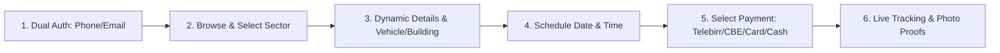

# Clean.et — Feature-Wise & Dashboard-Wise Operational Guide & Role Governance Manual

> **Document Version**: 1.0.0  
> **Release Date**: September 2026  
> **Target Audience**: Business Owners, Franchise Operators, Operations Managers, Field Crew Leads, and Platform Customers  
> **Scope**: Complete breakdown of what Clean.et delivers to users, how to use the platform step-by-step, and an exhaustive governance breakdown of **what each role CAN do and CANNOT do**.

---

## 1. Value Proposition: What Clean.et Delivers to Users

**Clean.et** is a modern on-demand cleaning and facility maintenance management platform built to solve the hassle, inconsistent quality, and arbitrary pricing of traditional car washing and facility cleaning in East Africa.

### 1.1 For Vehicle Owners & Drivers
* **Doorstep Mobile Detailing**: Cleaners arrive directly at the customer's home, office, or parking bay with mobile pressure-wash rigs, deionized water, and eco-friendly snow foam.
* **Valet Pick, Wash & Return**: Customers can schedule a trusted valet driver to pick up their car, detail it at a certified bay, and return it spotless.
* **Vehicle Garage**: Save vehicle records (Make, Model, Year, Color, Plate Number, Class) once, enabling one-tap bookings without re-entering car specs.
* **Recurring Maintenance Discounts**: Automatic discounts for recurring washes (15% off weekly, 10% off bi-weekly, 5% off monthly).

### 1.2 For Homeowners & Apartment Residents
* **Deep Residential Cleaning**: Specialized cleaning teams equipped with HEPA filtration vacuums, kitchen degreasers, and bathroom descalers.
* **Transparent Dynamic Pricing**: Upfront calculations based on room counts, floor plans, and service tiers—no hidden fees.
* **Vetted & Verified Cleaners**: All staff are background-checked, uniformed, and certified for home safety.

### 1.3 For Commercial Buildings, Corporate Offices & Facilities
* **High-Rise Facade Glass Washing**: Pure water-fed pole systems reaching up to 4 stories and certified scaffolding aerial crews.
* **Corporate Office Deep Sanitization**: Scheduled after-hours commercial sanitation for tech offices, banks, NGOs, and medical clinics.
* **Building Profiles**: Save facility square meters, floor count, and access instructions once for quick re-booking.
* **Official VAT Invoices**: Instant tax-compliant invoices and itemized receipts for corporate accounting.

### 1.4 For Corporate Fleet Managers
* **Consolidated Fleet Management**: Link dozens of corporate transport vans, trucks, and company cars under a single account with pooled billing.

---

## 2. End-User Step-by-Step Experience (How to Use Clean.et)



### Step 1: Account Creation & Authentication
1. Open the Clean.et application on Mobile (iOS / Android) or Web.
2. Toggle between **Phone Number** (`🇪🇹 +251 9...`) or **Email Address**.
3. Enter your verification OTP or secure password to sign in.

### Step 2: Browse & Discover Services
1. **Home Screen**: View featured seasonal promotions, active booking alerts, and verified service sectors.
2. **Explore Screen**: Search by keyword (e.g., *"mobile wash"*, *"facade glass"*, *"steam"*), filter by sector category (**Car Wash** or **Building Cleaning**), and sort by **Popularity**, **Customer Rating**, or **Price**.

### Step 3: Configure Booking Requirements
1. Click **Book Now** on any service or sector.
2. The dynamic requirement form automatically adapts:
   * **For Car Wash**: Select your saved vehicle from your garage (or enter vehicle class & plate number).
   * **For Building Cleaning**: Select your saved building profile (or enter square meters & floor count).
3. The live pricing engine instantly computes your estimated cost in Ethiopian Birr (ETB).

### Step 4: Schedule Frequency, Date & Time
1. Choose booking frequency:
   * **One-Time Wash** (Standard rate)
   * **Weekly Clean** (15% discount)
   * **Bi-Weekly Clean** (10% discount)
   * **Monthly Deep Clean** (5% discount)
2. Select your preferred date from the interactive calendar.
3. Choose a convenient arrival time slot (e.g., *09:00 AM*, *02:00 PM*).

### Step 5: Choose Payment Method
Select your preferred payment channel:
* **Telebirr** (Instant mobile wallet transfer)
* **Commercial Bank of Ethiopia (CBE / CBE Birr)**
* **Debit / Credit Card**
* **Cash on Delivery** (Pay field staff directly upon job completion)

### Step 6: Live Tracking & Photo Proof Verification
1. Open **Bookings** tab to view your active cleaning order.
2. Watch the live 6-stage status tracker:
   $$\text{Pending} \longrightarrow \text{Confirmed} \longrightarrow \text{Assigned} \longrightarrow \text{En Route} \longrightarrow \text{In Progress} \longrightarrow \text{Completed}$$
3. View your assigned technician’s name and contact number with a 1-tap call button.
4. Once cleaning is finished, inspect the **Before & After photo proofs** uploaded by the technician.
5. Download your official VAT tax invoice.

---

## 3. Role Governance Matrix: What Each Role CAN & CANNOT Do

Clean.et enforces strict Role-Based Access Control (RBAC) to ensure operational security, privacy, and accountability.

| Capability / Action | Customer (`customer`) | Field Crew / Cleaner (`staff`) | Tenant Branch Admin (`admin`) | Super Admin (`super_admin`) |
| :--- | :---: | :---: | :---: | :---: |
| **Browse public service catalog & get dynamic estimates** | ✅ CAN DO | ✅ CAN DO | ✅ CAN DO | ✅ CAN DO |
| **Book cleaning services & select recurring frequency** | ✅ CAN DO | ❌ CANNOT | ❌ CANNOT (uses CRM) | ❌ CANNOT |
| **Manage personal vehicle garage & building profiles** | ✅ CAN DO | ❌ CANNOT | ❌ CANNOT | ❌ CANNOT |
| **Download personal VAT invoices** | ✅ CAN DO | ❌ CANNOT | ✅ CAN DO (Branch) | ✅ CAN DO (Platform) |
| **Cancel own booking within policy window** | ✅ CAN DO | ❌ CANNOT | ✅ CAN DO | ✅ CAN DO |
| **Receive job dispatch alerts & customer arrival directions** | ❌ CANNOT | ✅ CAN DO | ❌ CANNOT | ❌ CANNOT |
| **Transition job status (En Route → In Progress → Completed)** | ❌ CANNOT | ✅ CAN DO | ✅ CAN DO | ✅ CAN DO |
| **Upload Before & After photo proofs & check off checklist** | ❌ CANNOT | ✅ CAN DO | ✅ CAN DO | ✅ CAN DO |
| **Toggle live duty availability (Available / Busy / Off-Duty)** | ❌ CANNOT | ✅ CAN DO | ✅ CAN DO (All Crew) | ❌ CANNOT |
| **Assign / Reassign technicians to incoming bookings** | ❌ CANNOT | ❌ CANNOT | ✅ CAN DO | ✅ CAN DO |
| **Create, update, or deactivate branch service packages & prices** | ❌ CANNOT | ❌ CANNOT | ✅ CAN DO (Own Branch) | ✅ CAN DO |
| **View branch revenue, pending orders, and urgent action tray** | ❌ CANNOT | ❌ CANNOT | ✅ CAN DO (Own Branch) | ✅ CAN DO (Global) |
| **Access branch customer CRM with order history & LTV spend** | ❌ CANNOT | ❌ CANNOT | ✅ CAN DO (Own Branch) | ✅ CAN DO (Global) |
| **Generate formal VAT invoices from completed bookings** | ❌ CANNOT | ❌ CANNOT | ✅ CAN DO (Own Branch) | ✅ CAN DO |
| **Access another franchise branch's customer or revenue data** | ❌ CANNOT | ❌ CANNOT | ❌ **STRICTLY BLOCKED** | ✅ CAN DO (Global View) |
| **Onboard new cleaning franchise companies & assign tiers** | ❌ CANNOT | ❌ CANNOT | ❌ CANNOT | ✅ CAN DO |
| **Set franchise commission percentages (e.g. 10%–15%)** | ❌ CANNOT | ❌ CANNOT | ❌ CANNOT | ✅ CAN DO |
| **Instant Kill-Switch (Activate / Suspend a franchise)** | ❌ CANNOT | ❌ CANNOT | ❌ CANNOT | ✅ CAN DO |
| **Run automated commission calculation & payout batches** | ❌ CANNOT | ❌ CANNOT | ❌ CANNOT | ✅ CAN DO |
| **Export platform-wide financial ledgers (CSV / Excel)** | ❌ CANNOT | ❌ CANNOT | ❌ CANNOT | ✅ CAN DO |
| **Inspect immutable platform security audit logs** | ❌ CANNOT | ❌ CANNOT | ❌ CANNOT | ✅ CAN DO |
| **Monitor server health, DB latency & queue workers** | ❌ CANNOT | ❌ CANNOT | ❌ CANNOT | ✅ CAN DO |
| **Send platform broadcasts (All, Customers, Crew, Admins)** | ❌ CANNOT | ❌ CANNOT | ❌ CANNOT | ✅ CAN DO |

---

## 4. Super Admin Role & Governance Dashboard

### 4.1 Purpose & Mandate
The **Super Administrator** (`super_admin`) is the executive authority of the Clean.et platform. Their role is to ensure platform uptime, onboard and monitor cleaning franchises, manage revenue share contracts, reconcile financial payouts, and maintain security and compliance across the entire ecosystem.

```
Super Admin Governance Cockpit Hierarchy:
├── /super-admin/analytics (Global Gross Merchandise Value [GMV], Commission pool, Category heatmaps)
├── (admin)/tenants (Franchise partner onboarding, Subscription tiers, Commission % rules, Kill-switch)
├── /super-admin/payouts (Automated net payout calculation, Settlement state machine, Digital receipts)
├── /super-admin/reports (Multi-tenant filtered reporting, CSV/Excel ledger exports)
├── /super-admin/health (Server infrastructure telemetry, Database latency, Redis cache, Workers)
├── /super-admin/audit-logs (Immutable platform security audit trail)
├── /super-admin/broadcast (Omnichannel push notifications & SMS broadcast engine)
└── /super-admin/settings (Global platform fee rates, default currency, operating tax parameters)
```

### 4.2 What Super Admin CAN Do
1. **Global GMV & Analytics Oversight**:
   * View total Gross Merchandise Value (GMV) across all franchises in ETB.
   * Monitor real-time platform commission earnings.
   * View rolling 12-month revenue trajectory graphs comparing GMV against platform commissions.
   * Analyze service category demand heatmaps across Car Wash vs. Building Cleaning.
2. **Franchise Partner Onboarding & Governance**:
   * Register new cleaning franchise companies with business details, license numbers, and branch locations.
   * Assign subscription tiers: **Starter**, **Growth**, or **Enterprise**.
   * Configure authorized cleaning categories per partner (e.g., restrict a partner to automotive washes only or permit full facility sanitation).
   * Set custom negotiated commission percentages (e.g., 10%–15%).
   * **Instant Kill-Switch**: Suspend any delinquent or compromised franchise with 1 click (suspension immediately revokes all active API tokens for that tenant).
   * Provision primary and secondary Tenant Administrator accounts.
3. **Automated Settlement & Payout Engine**:
   * Run automated monthly or bi-weekly payout batch calculations using the platform formula:
     $$\text{Net Payout} = \text{Gross Completed Bookings} - \text{Platform Commission} - \text{Processing Fees}$$
   * Advance payouts through the 4-stage lifecycle: `Pending` $\rightarrow$ `Processing` $\rightarrow$ `Paid` $\rightarrow$ `Reconciled`.
   * Generate and download digital payout settlement receipts and CSV ledger exports.
4. **Platform Security & Diagnostics**:
   * Review immutable audit logs capturing timestamps, user ID, actor name, action verb, target entity, client IP address, and payload diffs.
   * Monitor real-time infrastructure diagnostics: MySQL/PostgreSQL latency, Redis cache health, server uptime, and background queue workers.
5. **System-Wide Broadcast Messaging**:
   * Dispatch push notifications and SMS broadcasts targeted by audience: **All Users**, **Customers Only**, **Cleaning Staff Only**, or **Franchise Administrators Only**.

### 4.3 What Super Admin CANNOT / SHOULD NOT Do
* **CANNOT Perform Field Cleanings**: Super Admin accounts do not accept or execute physical cleaning orders.
* **SHOULD NOT Micro-Manage Daily Dispatch**: Super Admins should not assign individual cleaners for daily jobs; this is the responsibility of the Tenant Branch Admin.
* **CANNOT Tamper with Audit Logs**: Audit log entries are write-only / immutable and cannot be deleted or modified by any administrator.
* **SHOULD NOT Alter Historical Completed Bookings Without Audit**: Any financial correction must go through dispute adjustment workflows.

---

## 5. Tenant Admin (Sector / Branch Admin) Operations Manual

### 5.1 Purpose & Mandate
The **Tenant Administrator** (`admin` / `tenant_admin`) manages the daily operations of an individual cleaning franchise or business branch (e.g., *"Addis Sparkling Wash & Detail"*). All database queries executed by a Tenant Admin are automatically scoped by an Eloquent global filter (`WHERE tenant_id = ?`).

```
Tenant Admin Operations Command Center:
├── (admin)/(tabs)/dashboard (Today's GMV, Active cleaners on duty, Pending bookings, Urgent action tray)
├── (admin)/(tabs)/bookings (Kanban pipeline: Pending, Confirmed, In Progress, Completed, Cancelled)
├── (admin)/booking-details (Customer requirement inspect, Technician dispatch modal)
├── (admin)/services (Branch service catalog CRUD, Base pricing, Durations, Dynamic schema association)
├── (admin)/staff (Technician roster, Duty availability toggles, Skill certifications)
├── (admin)/customers (CRM client directory, Lifetime order count, LTV spend)
├── (admin)/invoices (Booking-to-invoice conversion, VAT calculation, Payment status tracking)
├── (admin)/invoice-details (Itemized receipt view, Print & download)
└── (admin)/reports (Branch revenue trends, Booking volume charts, Staff productivity)
```

### 5.2 What Tenant Admin CAN Do
1. **Daily Operations Command**:
   * Monitor today's gross billings in ETB, active technicians on duty, and daily completed milestones.
   * Address the **Urgent Action Tray** to immediately dispatch high-priority jobs scheduled for current time slots.
2. **Kanban Booking Dispatch Pipeline**:
   * Filter and track bookings across status tabs: `All`, `Pending`, `Confirmed`, `In Progress`, `Completed`, and `Cancelled`.
   * Search jobs instantly by customer name, booking ID, phone number, or scheduled date.
   * Open the **Technician Assignment Modal** to inspect customer requirements and assign certified, available technicians.
3. **Branch Service Catalog Management**:
   * Add, edit, or deactivate cleaning packages under the franchise's authorized categories.
   * Set base rates, hourly rates, or per-square-meter formulas.
   * Define estimated service duration (e.g., *45 min*, *90 min*, *3 hours*) for accurate scheduling.
   * Link packages to dynamic backend requirement schemas.
4. **Technician Roster & Certification Management**:
   * Maintain staff dossiers (name, phone, employment date, performance history).
   * Toggle staff duty status (`Available`, `Busy`, `Off-Duty`).
   * Record specialized certifications (e.g., *Industrial Steam Detailing*, *Facade Scaffolding*, *Chemical Safety*).
5. **Customer Relationship Management (CRM)**:
   * Access the centralized directory of all customers who have booked with the branch.
   * View customer lifetime booking count, total spend (LTV), and contact options.
6. **Invoicing & Billing**:
   * Convert completed bookings into official VAT invoices with 1 tap.
   * Track invoice payment statuses (`unpaid`, `partially_paid`, `paid`, `overdue`).
   * Print and download itemized customer receipts.
7. **Branch Analytics & Reporting**:
   * View monthly revenue graphs, volume trends, and staff completion metrics.

### 5.3 What Tenant Admin CANNOT Do
* **CANNOT View Other Franchises' Data**: Strictly isolated at the database level by `TenantScope`. Tenant Admin A cannot see Tenant Admin B's bookings, revenue, or clients.
* **CANNOT Alter Platform Commission Rates**: The commission percentage owed to Clean.et is locked by the contract configured by the Super Admin.
* **CANNOT Onboard New Franchises**: Cannot create new tenant companies or issue platform-level licenses.
* **CANNOT Access Super Admin System Diagnostics**: Cannot view server infrastructure health, database connection latency, or Redis cache metrics.
* **CANNOT Trigger Platform-Wide Broadcasts**: Cannot send push or SMS notifications to users outside their own registered customer and staff pool.

---

## 6. Field Crew / Technician Mobile Operational Guide

### 6.1 Purpose & Mandate
**Field Technicians and Cleaning Crew** (`staff`) are the mobile workforce delivering physical cleaning services at the customer's doorstep, valet facility, or commercial property.

### 6.2 What Field Crew CAN Do
1. **Receive Instant Job Dispatches**:
   * Receive push notifications when assigned to a job by their branch dispatcher, with service time, address, and special customer notes.
2. **Turn-by-Turn Navigation**:
   * 1-tap deep linking to mobile navigation apps (Google Maps) directly to the customer's vehicle parking spot or building gate.
3. **Real-Time Job Progression**:
   * Update job status as work progresses:
     * Tap **"En Route"** when departing for the site.
     * Tap **"In Progress"** upon arrival and commencing cleaning.
     * Tap **"Completed"** when detailing is finished.
4. **Upload Photographic Proof of Work**:
   * Capture and upload high-resolution **Before & After photos** (e.g., dirty floor mats vs. extracted clean mats, unwashed facade glass vs. polished crystal glass).
5. **Quality Checklist Sign-Off**:
   * Check off mandatory inspection points (e.g., rims cleaned, door jambs wiped, glass dried without streaks, equipment packed) before job closeout.
6. **Toggle Duty Availability**:
   * Mark themselves as `Available` for incoming dispatch or `Off-Duty` when shift concludes.

### 6.3 What Field Crew CANNOT Do
* **CANNOT Modify Service Pricing**: Field staff cannot change the calculated price or discount rules on a booking.
* **CANNOT Assign Jobs to Other Cleaners**: Dispatching is exclusively managed by the Tenant Branch Admin.
* **CANNOT Access Financial Ledgers or Invoices**: Crew members only see the operational job card (tasks, address, vehicle specs) without administrative accounting data.
* **CANNOT View Other Cleaners' Jobs**: Staff only view jobs assigned directly to their own account.

---

## 7. Platform Screen Catalog & Access Mapping

| Screen / Feature Area | Route / URL | Allowed Roles | Core Functionality |
| :--- | :--- | :--- | :--- |
| **Dual Authentication** | `/(auth)/login`, `/(auth)/register` | Public / All | Phone/Email OTP & password login |
| **Home Dashboard** | `/(tabs)/home` | Customer | Hero carousel, sectors, active booking alert |
| **Explore Directory** | `/(tabs)/explore` | Customer | Search, sort by rating/price, category filters |
| **Dynamic Sector Booking** | `/booking/[sectorId]` | Customer | Live dynamic form, vehicle/building select, calendar |
| **Live Tracking & Proofs** | `/booking/status/[bookingId]` | Customer, Staff, Admin | 6-stage tracker, crew info, photo proof inspection |
| **Vehicle Garage** | `/vehicles` | Customer | Register & manage vehicles (Make, Model, Plate) |
| **Building Profiles** | `/building-profiles` | Customer | Save property specs (sqm, floors, access notes) |
| **Corporate Fleet Accounts** | `/profile/fleet` | Customer | Link multi-vehicle corporate accounts |
| **Customer Invoices** | `/invoices`, `/invoices/[id]` | Customer | View & download VAT-compliant tax receipts |
| **Payment Methods** | `/profile/payments` | Customer | Link Telebirr, CBE, and bank cards |
| **Tenant Dashboard** | `/(admin)/(tabs)/dashboard` | Tenant Admin | Today's GMV, active crew, pending orders, urgent tray |
| **Kanban Booking Dispatch** | `/(admin)/(tabs)/bookings` | Tenant Admin | Booking pipeline, search, technician assignment modal |
| **Branch Service Catalog** | `/(admin)/services` | Tenant Admin | Add/edit services, set pricing formulas & duration |
| **Crew Roster & Certifications** | `/(admin)/staff` | Tenant Admin | Manage staff dossiers, availability & certifications |
| **Customer CRM Directory** | `/(admin)/customers` | Tenant Admin | Client list, lifetime orders, total spend (LTV) |
| **Branch Invoice Management** | `/(admin)/invoices` | Tenant Admin | 1-tap invoice generation from completed jobs |
| **Branch Reports & Analytics** | `/(admin)/reports` | Tenant Admin | Monthly revenue, booking volume, staff productivity |
| **Global Analytics Cockpit** | `/super-admin/analytics` | Super Admin | Platform GMV, commission pool, category demand |
| **Tenant Partner Management** | `/(admin)/tenants` | Super Admin | Franchise onboarding, tiers, commission %, kill-switch |
| **Automated Payout Engine** | `/super-admin/payouts` | Super Admin | Net payout calculation, settlement states, receipts |
| **Audit Logs & Security** | `/super-admin/audit-logs` | Super Admin | Immutable administrative activity trail |
| **Infrastructure Health** | `/super-admin/health` | Super Admin | DB latency, cache memory, queue workers, uptime |
| **Platform Broadcast Engine** | `/(admin)/broadcast` | Super Admin | Push/SMS broadcast targeted by audience role |

---

## 8. Summary & Best Practice Workflow

1. **For Customers**: Discover services through **Explore**, configure requirements via dynamic forms, track in real time, and verify work through **Before/After photo proofs**.
2. **For Field Staff**: Keep duty status updated, follow turn-by-turn navigation, advance job states on-site, and upload photo proofs before closing jobs.
3. **For Tenant Admins**: Actively monitor the **Urgent Actions Tray**, dispatch certified technicians via the **Kanban Pipeline**, maintain up-to-date pricing, and generate formal VAT invoices upon job completion.
4. **For Super Admins**: Oversee platform GMV growth, onboard quality franchise partners, review security audit trails, and execute automated commission payout batches.
